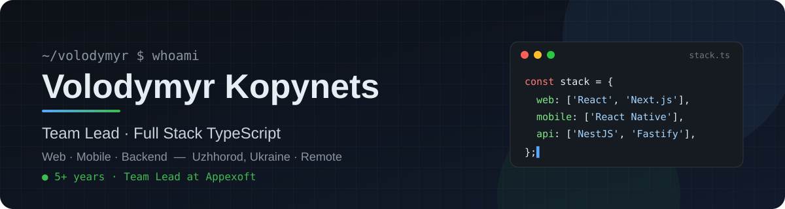

<div align="center">



<!-- Contact buttons: uncomment and fill in when ready
[](https://linkedin.com/in/YOUR_LINKEDIN)
[](mailto:YOUR_EMAIL)
[](https://YOUR_CV_LINK)
-->

</div>

---

```bash
$ whoami
```

```yaml
name: Volodymyr Kopynets
role: Team Lead / Full Stack Developer @ Appexoft   # since 2024
experience: 5+ years
started_with: iOS          # before moving to web
education: B.Sc. + M.Sc. Computer Engineering, Uzhhorod National University
languages: [Ukrainian (native), English (professional)]
```

```bash
$ cat now.yml
```

```yaml
learning:
  - AI engineering
  - system design
```

---

### 🛠️ Stack

<p align="center">
  
</p>

<p align="center">
  <sub>React Native · Fastify · Stripe · OpenAI API</sub>
</p>

---

### 📊 Activity

<p align="center">
  <picture>
    <source media="(prefers-color-scheme: dark)" srcset="https://github-readme-activity-graph.vercel.app/graph?username=linch433&theme=github-compact&hide_border=true&bg_color=0d1117" />
    
  </picture>
</p>
